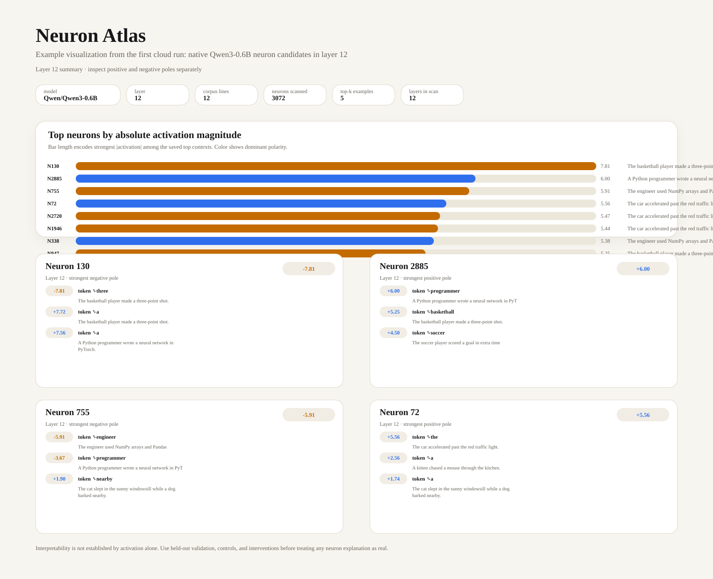

# Neuron Atlas

**Mapping, interpreting, and causally validating native neurons in open-weight language models.**

Independent exploratory reproduction inspired by Nick Cammarata's [*Neural Networks Are Already Clean*](https://already-clean.goodfire.com/). Not affiliated with Goodfire.



## What this repository does

This project studies **native MLP neurons** in [Qwen3-0.6B](https://huggingface.co/Qwen/Qwen3-0.6B) directly, without first fitting a sparse autoencoder.

We hook the input to each selected MLP `down_proj`:

```text
SiLU(gate_proj(x)) * up_proj(x)
```

This is a **native MLP intermediate neuron**, not a residual-stream dimension.

## Outputs generated on every run

Each GitHub Actions experiment now produces:

- `results/scan.json` — top activating examples by neuron
- `results/report.md` — text summary of candidate neurons
- `results/scan_layer12.svg` — polished visual summary for the repo / artifacts
- `results/validation.md` and `results/validation.json` — held-out AUROC checks for example neuron hypotheses
- `results/interventions.md` — baseline vs ablated generations for example prompts

## Quick start

```bash
python -m venv .venv
source .venv/bin/activate
pip install -r requirements.txt

python -m src.scan --corpus data/prompts.txt --out results/scan.json --max-lines 30 --top-k 8
python -m src.report --scan results/scan.json --out results/report.md --layer 12
python -m src.visualize --scan results/scan.json --out results/scan_layer12.svg --layer 12
python -m src.validate --dataset data/validation_examples.jsonl --hypotheses data/hypotheses.example.json --out results/validation.md --out-json results/validation.json
python -m src.intervention_batch --hypotheses data/hypotheses.example.json --prompts data/intervention_prompts.jsonl --out results/interventions.md
pytest -q
```

## Research workflow

1. **Scan**: gather strongest post-gating activations, token contexts, and signs.
2. **Explain**: propose semantic functions for positive and negative poles separately.
3. **Visualize**: generate a clean visual summary suitable for quick review.
4. **Validate**: score hypotheses on held-out labeled examples and compute AUROC.
5. **Control**: compare against random neurons from the same layer.
6. **Intervene**: suppress or scale a neuron and compare generations.
7. **Scale up**: run larger corpora, more layers, and better curated evaluation sets.

## Current example hypotheses

These are just starting points from the first cloud run, not established findings:

- **Neuron 947 (layer 12, negative pole)** — sports / player cue
- **Neuron 755 (layer 12, negative pole)** — technical profession cue
- **Neuron 2033 (layer 12, negative pole)** — Paris / Eiffel Tower cue

## Scientific limitations

- Top activations are useful clues, not proof of interpretability.
- The example validation dataset is small and hand-written.
- AUROC on a toy held-out set is a screening tool, not a definitive claim.
- Greedy generation differences alone do not establish a full causal circuit.
- Goodfire's broader cleanliness claims are **not** reproduced here.

## Cloud runs

A manually triggered GitHub Actions workflow is available here:

- [Native neuron scan workflow](https://github.com/KevinmKrieg/neuron-atlas/actions/workflows/neuron-scan.yml)

## Roadmap

- [x] Native MLP activation hooks and top-context extraction
- [x] Per-layer Markdown reports
- [x] Beautiful auto-generated SVG visualization
- [x] Example visual embedded on repo front page
- [x] Held-out AUROC validation scaffold
- [x] Random-neuron control baseline scaffold
- [x] Batch intervention examples
- [ ] Larger curated corpus and multi-layer study
- [ ] Interactive neuron explorer
- [ ] SAE comparison and model-size study

## References

- [Goodfire essay](https://already-clean.goodfire.com/)
- [Qwen3-0.6B](https://huggingface.co/Qwen/Qwen3-0.6B)

MIT License.
